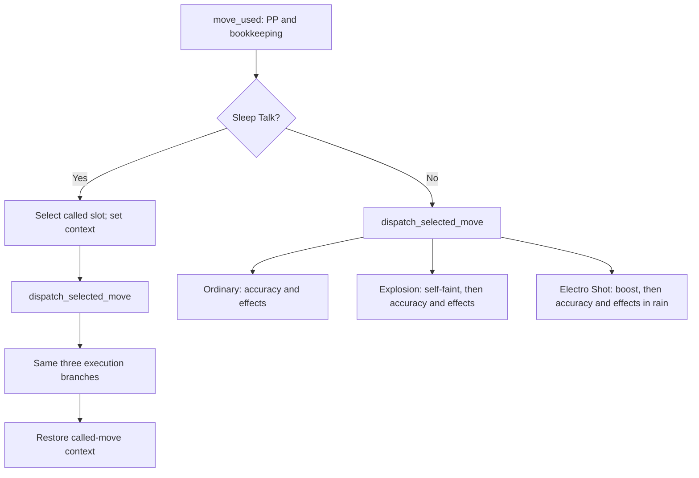
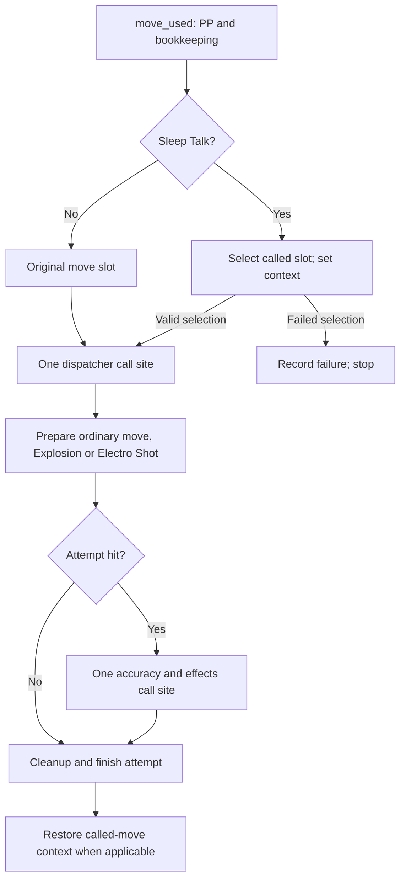
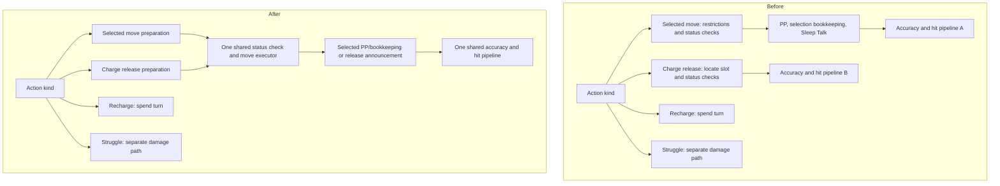
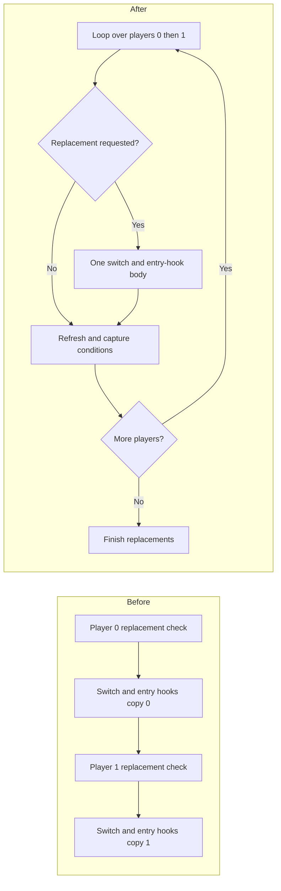
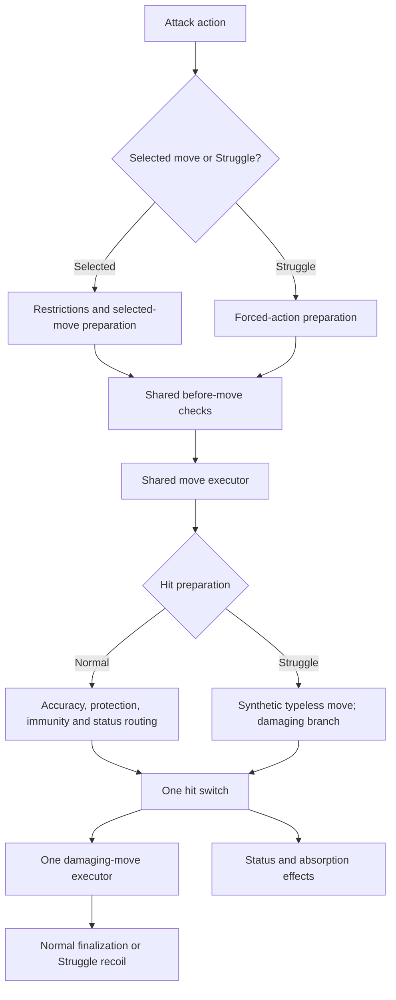

# Compilation memory measurements

The initial full singles step exceeded the tested backend compilation budgets.
Read/write optimizations reduced tracing work; the subsequent dispatch refactor
also reduced backend compilation time and memory for the selected-move
dispatcher and full move execution. Historical measurements are retained below.
Full-battle and transformation acceptance are separate from component checks.
The latest [full-step dispatch consolidation](#full-step-dispatch-consolidation)
now compiles the complete step within the 4 GiB RSS budget.

## Measurements

Measurements on 2026-11-13 use fresh CPU processes pinned to two cores, the same
curated seed-0 teams with abilities/items enabled, and a single full step.
Equation counts include each shared nested Jaxpr once. Trace times exclude
fixture construction. RSS is the process high-water mark, including fixture
construction and earlier phases; it is not the size of live battle arrays.

| Implementation | Traced equations | Trace seconds | Peak RSS after trace (MiB) | Peak RSS after lowering (MiB) |
| --- | ---: | ---: | ---: | ---: |
| Before this optimization | 802,117 | 96.234 | 1,801.0 | Not measured separately |
| Shared active gather, direct ability reads, no zero-width padding | 258,034 | 21.794 | 855.7 | 2,280.8 |
| Shared dynamic tree indexing | 81,237 | 9.849 | 633.4 | 1,653.5 |
| Field-only updates and direct hazard/party reads | 70,666 | 7.982 | 618.5 | 1,538.5 |

The final trace has about 91% fewer equations, takes about 92% less time and
uses about 66% less peak RSS at the tracing checkpoint than the original.
These are preparation measurements, not rollout throughput measurements.

## Changes

- `BattleState.ability` gathers the stored ability leaf directly before applying
  volatile overrides and suppression.
- Active snapshots and dynamic `ArrayTree` indexing share cached JAX functions.
  Slice/Ellipsis syntax retains ordinary tree indexing.
- `Move` pads short stat-change vectors only; reconstructing an already-padded
  tree no longer introduces six zero-width padding calls.
- `update_active_fields` writes only named array leaves and emits status events
  when status is part of the update. HP, item, typing and status operations use
  this path. Full `update_active` remains available for Pokémon replacement.
- PP consumption updates its bank leaf directly. Hazard and Beat Up eligibility
  reads avoid constructing unrelated side or party data.

Names of updated fields and index syntax are static Python structure; player
indices, slots, values and random keys remain dynamic. The changes preserve
immutable state and explicit randomness. Focused checks cover full-replacement
equivalence (including dtype casts/events), mechanics regressions and actual
`jit`/`vmap`/`scan` on the shared indexing and update helpers.

## Backend limits before the dispatch refactor

Whole-step backend compilation still failed under a 6 GiB virtual-address cap.
A separate measurement with an 8 GiB virtual cap and a 4 GiB RSS watchdog stopped
the backend at approximately 4.02 GiB RSS. The watchdog samples every 50 ms, so
its threshold is not an exact kernel-enforced RAM limit. Virtual address space
also includes reserved allocator arenas and thread stacks.

Disabling XLA's `call-inliner` pass still exceeded the RSS threshold. Disabling
`flatten-call-graph` as well failed during reset with “Call graph must be
flattened before copy insertion.” Neither experiment is a supported workaround
or a project default.

These experiments motivated reducing the backend's expanded control-flow/call
graph. Shared JAX traces reduce frontend duplication; they do not guarantee that
XLA retains shared calls. The earlier 40-turn eager rollout predates these
optimizations.

## Reproduce

Use the configured project interpreter in a fresh process. On this Linux CPU
environment, the bounded full-step profile is:

```bash
ulimit -c 0
ulimit -v 8388608
taskset -c 0,1 env OMP_NUM_THREADS=1 MPLCONFIGDIR=/tmp/ninjax-mpl \
  .venv/bin/python tools/profile_compile.py --stage compile --rss-limit-mib 4096
```

Use `--stage trace` or `--stage lower` to stop before backend compilation.
`--target ability` isolates the effective-ability read. Reports are JSON lines
with flushed phase progress, elapsed time, peak RSS and traced graph counts.
The script's RSS watchdog exits with code 137 when its threshold is exceeded.
The default RSS limit is zero (disabled); choose a suitable budget explicitly.

## Profiling tools

The project environment includes the optional XProf package, declared in
[`requirements-profiling.txt`](../../requirements-profiling.txt). Its `xprof`
command can serve and inspect JAX profiler traces. Capture a trace from Python
with `jax.profiler.start_trace(log_dir)`, run the workload, and call
`jax.profiler.stop_trace()`, then open the resulting log directory with
`xprof server --logdir <log_dir>`.

JAX's compilation diagnostics and IR dumps are already available through the
installed JAX/XLA stack; they do not need separate packages. Useful settings
include `JAX_LOG_COMPILES=1`, `JAX_EXPLAIN_CACHE_MISSES=1`,
`JAX_DUMP_IR_TO=/tmp/jax-ir`, and
`JAX_DUMP_IR_MODES=eqn_count_pprof`. XLA HLO pass dumps can be restricted to
selected passes with `XLA_FLAGS`, for example:

```bash
XLA_FLAGS="--xla_dump_to=/tmp/xla-dump --xla_dump_hlo_pass_re=call-inliner|flatten-call-graph"
```

Perfetto's trace viewer is a browser UI at [ui.perfetto.dev](https://ui.perfetto.dev/);
it opens local trace files without a separate package install.

The standalone `hlo-opt` executable is not installed. OpenXLA documents it as a
Bazel build target from the XLA source tree (`//xla/hlo/tools:hlo-opt` or
`//xla/tools:hlo-opt`), rather than as a Python package. This environment has
no Bazel/Bazelisk installation, and building that tool would require setting up
the OpenXLA source build and its toolchain.

## Move-dispatch flow before and after

These diagrams show call sites in the compiled program. At runtime, only the
selected conditional branch executes. Failed Sleep Talk selection stops before
dispatch; a dry Electro Shot charge or a blocked move skips hit resolution.

Before, the two outer branches each call the dispatcher. Within each dispatcher,
three branches can independently call the full accuracy/effect pipeline:



After, selection returns a slot and permission to execute. Special moves prepare
state and return permission to attempt a hit. Each layer then has one common
execution call site:



JAX traces both sides of a dynamic `lax.cond`: the executable must support other
move IDs without recompiling. The full hit pipeline includes status callbacks in
`curated_move_effects.py`, damaging hits, multi-hit scans, abilities, items and
events. Repeating it in separate branches increases the code XLA may expand,
optimize and lower to machine code. A nested `jax.jit` can share a traced Jaxpr
without guaranteeing shared backend code after call-graph flattening/inlining.

Moving selection and preparation before the shared call reduces this expansion.
It preserves PP payment, PRNG order, Explosion's pre-hit faint, Electro Shot's
boost/charge timing and called-move cleanup. It does not mean every move executes
all branches, nor does it establish a faster warmed battle step; that requires a
separate execution benchmark.

## Component compilation tests

`unit_tests/test_component_compilation.py` checks 18 components separately:
ability/active reads, field updates, stats, power, HP, status application,
secondaries, contact effects, one damaging hit, multi-hit resolution, status
moves, before-action checks, switching, field effects, observations, selected-move
dispatch and full move execution. Dispatch executes an already-selected move;
move execution additionally includes PP/bookkeeping and Sleep Talk selection.
These are isolated component checks, not complete battle acceptance.

Each test launches a fresh interpreter with two available CPU cores, an 8 GiB
virtual-address cap, a 4 GiB RSS watchdog, disabled core dumps and a 180-second
timeout. Tests run sequentially. Player and move-slot indices, team metadata and
state remain dynamic inputs to compilation. Curated seed-0 teams use enabled
abilities/items; component-specific move fixtures exercise relevant effects.
For example, contact uses U-turn against Rough Skin and Rocky Helmet, and
multi-hit uses Population Bomb.

The common fixture is constructed before timing starts. Its nested JAX helpers
may already have compiled during reset; the outer component function is new in
each child. RSS checkpoints include this fixture and preparation. Phase timings
exclude fixture construction, while the recorded subprocess wall time includes
fixture construction and eager validation.

After compiling and executing, the test compares every returned leaf with eager
execution using the same input/key. Shapes, dtypes, integer values and PRNG keys
must match exactly. Floating-point leaves must be finite and match within
`rtol=atol=1e-5`. This checks one fixture per component; it is not exhaustive
mechanics parity or a batching/scan check.

Record machine-readable results (including failures) with:

```bash
NINJAX_COMPONENT_REPORT=/tmp/ninjax-components.json \
  MPLCONFIGDIR=/tmp/ninjax-mpl .venv/bin/python -m pytest --run-jit -v \
  unit_tests/test_component_compilation.py \
  --junitxml=/tmp/ninjax-components.xml -o junit_family=legacy
```

The module report includes raw phase checkpoints, graph counts, process exit
codes, error excerpts and wall time. A memory stop, native compiler failure,
timeout or compiled/eager mismatch fails its test; it is not counted as a pass
or silently skipped. The report is written during module teardown even when
tests fail. Normal pytest runs deselect these opt-in `jit` checks.

To run one component directly, use the project interpreter:

```bash
.venv/bin/python tools/profile_compile.py --target hit --stage compile --check \
  --cpu-count 2 --virtual-limit-mib 8192 --rss-limit-mib 4096
```

## Component results before the dispatch refactor

Recorded on 2026-11-13 using Python 3.14.9, JAX 0.12.0.1, jaxlib 0.11.2 and the CPU backend with default XLA flags. The 18 checks ran in three sequential pytest selections with the limits above. **17 passed; full move execution hit the RSS watchdog during backend compilation.** No completed component had a compiled/eager mismatch.

Raw phase records, graph primitive counts and failure output are in [compilation-components.json](compilation-components.json).

| Component | Equations | Trace s | Lower s | Backend s | Peak RSS through compile (MiB) | Result |
| --- | ---: | ---: | ---: | ---: | ---: | --- |
| `ability` | 39 | 0.010 | 0.003 | 0.024 | 520.7 | Pass + eager match |
| `active` | 704 | 0.012 | 0.016 | 0.121 | 533.6 | Pass + eager match |
| `update` | 66 | 0.013 | 0.011 | 0.049 | 532.9 | Pass + eager match |
| `stats` | 1,610 | 0.031 | 0.031 | 0.137 | 534.1 | Pass + eager match |
| `power` | 2,142 | 0.068 | 0.037 | 0.146 | 539.3 | Pass + eager match |
| `hp` | 3,935 | 0.343 | 0.123 | 0.889 | 670.7 | Pass + eager match |
| `status` | 1,768 | 0.053 | 0.047 | 0.251 | 568.9 | Pass + eager match |
| `secondary` | 3,672 | 0.366 | 0.196 | 0.957 | 685.8 | Pass + eager match |
| `contact` | 6,386 | 0.546 | 0.280 | 2.372 | 813.4 | Pass + eager match |
| `hit` | 16,042 | 1.562 | 0.790 | 7.139 | 1,187.3 | Pass + eager match |
| `multi_hit` | 18,306 | 1.826 | 1.299 | 10.049 | 1,324.4 | Pass + eager match |
| `status_move` | 19,153 | 1.776 | 1.100 | 10.185 | 1,562.7 | Pass + eager match |
| `before_move` | 2,702 | 0.167 | 0.226 | 0.869 | 665.8 | Pass + eager match |
| `switch` | 6,597 | 0.563 | 0.278 | 2.994 | 891.9 | Pass + eager match |
| `field` | 11,159 | 0.973 | 0.587 | 4.132 | 1,063.4 | Pass + eager match |
| `observe` | 1,310 | 0.055 | 0.050 | 0.480 | 574.7 | Pass + eager match |
| `dispatch` | 36,286 | 3.877 | 3.467 | 104.575 | 3,530.1 | Pass + eager match |
| `move` | 38,373 | 4.126 | 3.811 | — | 4,111.2 | RSS limit |

Trace/lower/backend columns are phase durations, not cumulative elapsed time. The RSS column is a cumulative process high-water mark through compilation (or the watchdog stop), including fixture construction; later eager-validation peaks remain in the JSON. A dash means compilation did not complete, so no backend duration is reported. These values are observations, not portable performance thresholds.

These baseline results narrowed the investigation to the larger execution graph,
including Sleep Talk selection/calling and bookkeeping, rather than individual
hit arithmetic alone. The tests do not attribute excess memory to a single
compiler pass.

## Dispatch refactor measurements

Both affected components were rerun in fresh processes with the same fixtures,
two cores, default XLA flags and memory/time limits. Both compiled, executed and
matched every eager output leaf, including the PRNG key. Raw checkpoints are in
[compilation-dispatch-refactor.json](compilation-dispatch-refactor.json).

| Component | Equations before → after | Backend seconds before → after | Peak RSS through compilation before → after (MiB) |
| --- | ---: | ---: | ---: |
| `dispatch` | 36,286 → 34,401 | 104.575 → 33.479 | 3,530.1 → 2,238.7 |
| `move` | 38,373 → 36,532 | Did not finish → 34.574 | Watchdog stopped at 4,111.2 → 2,163.2 |

Dispatcher backend time decreased about 68% and its peak process RSS decreased
about 37% in these single-run observations. There is no completed pre-refactor
backend duration for full move execution, so no speedup ratio is reported for
that component. These are not repeated statistical benchmarks or warmed runtime
measurements.

The modest reduction in unique traced equations (about 5% for the dispatcher)
accompanies a much larger backend improvement. This is consistent with fewer
expanded hit-pipeline call sites: the graph counter counts shared nested
Jaxprs once, whereas backend transformations can expand calls at their uses.
The comparison changes both dispatch layers together and does not separately
attribute savings to Sleep Talk versus Explosion/Electro Shot preparation.

Mechanics validation passed 48 eager cases across Sleep Talk, charging/recharge,
self-KO moves, crash damage and action-dependent moves. An additional compiled
Sleep Talk check passed five fixtures through one executable: called High Jump
Kick, Explosion, Calm Mind, Rest and an awake failure. It compared every output
leaf and key with eager execution and peaked at 2,157.6 MiB RSS in the guarded
pytest process. The two remeasured component checks also passed compiled/eager
comparison. Full environment `vmap`/`scan` acceptance remains separate.

The full-step retry traced 68,829 equations in 8.886 seconds and lowered at
15.492 seconds cumulative elapsed time, with 1,287.1 MiB peak RSS. Backend
compilation still crossed the 4 GiB watchdog, which stopped the process at
4,107.2 MiB. A guarded end-to-end pytest retry also stopped without producing a
completed test result. No compiled full battle is claimed after this refactor.
The full-step phase records are included in the refactor JSON report.

Move execution/dispatch remains the largest measured component compilation
workload: backend time is about 33–35 seconds versus about 10 seconds for status
moves or multi-hit resolution. These are overlapping component measurements,
not exclusive function timings. They identify a priority for further work but
do not prove dispatch alone explains the full-step memory limit. Combining it
with action branches, continuations, switching and field processing can expand
the backend graph further; that integration needs additional profiling.

## Full-step dispatch consolidation

HLO pass dumps and a JAX/XProf host timeline identified expansion across the
action dispatcher. Ordinary moves and charge releases had independent calls
into the accuracy/hit pipeline; Struggle also has its own damage path. The
full-step HLO grew from 131,985 instructions to 587,633 during initial
call-graph flattening. A fresh baseline again crossed the 4 GiB RSS guard
(4,132.6 MiB observed) before compilation completed.

Selected moves and charge releases now prepare their different bookkeeping
before entering one `step_move`/`move_used`/`dispatch_selected_move` execution
path. Releases locate the stored move slot, honor Disable, clear charging once,
skip PP/Encore selection and skip the initial charge/boost setup. Recharge
still spends its turn before any status interruption checks. Struggle retains
its existing separate path.



The replacement phase also uses one sequential `lax.fori_loop` body instead
of two Python-expanded copies of switching and entry hooks. It still processes
player 0 before player 1 and snapshots conditions after each player.



| Full-step HLO checkpoint | Before | Shared charge execution | Plus shared replacement loop |
| --- | ---: | ---: | ---: |
| Before optimization | 131,985 | 102,303 | 99,731 |
| After initial call-graph flattening | 587,633 | 409,084 | 381,214 |
| After call inlining | 344,239 | 231,523 | 214,215 |
| Final CPU HLO | 387,998 | 260,596 | 241,940 |

The final graph has about 35% fewer instructions after flattening and 38% fewer
in final CPU HLO. Unique traced equations fall only from 68,829 to 65,701:
sharing traced subgraphs alone understates backend duplication. These static
instruction counts include cloned computations and tuple/parameter plumbing;
they are neither runtime operation counts nor exclusive function costs.

The charge-sharing change compiled in 89.739 backend seconds at 3,349.4 MiB
peak process RSS, then matched all 243 eager output leaves. Adding the shared
replacement loop compiled in 84.066 backend seconds at 3,217.0 MiB and also
matched all leaves. Those runs used two cores, the existing 8 GiB virtual cap,
4 GiB RSS guard and filtered HLO dumps. The latter run additionally recorded
host events; exporting its oversized trace exceeded the guard **after**
compilation, execution and eager validation. This motivated narrowing trace
capture to exclude fixture construction and eager validation. These timings
are individual observations on a shared host, not statistical speedup claims.

With the narrowed capture and default XLA flags, a fresh full-step run
completed backend compilation in **77.440 seconds at 3,174.2 MiB RSS**. Trace
export and the subsequent 243-leaf eager comparison both passed; peak RSS for
the entire process was 3,277.9 MiB. The finalized timeline shows substantial
remaining cost in HLO simplification (14.047 seconds), copy insertion (9.568
seconds), and 1,464 fusion compilations (10.667 seconds summed event duration).
These are inclusive, potentially overlapping spans, not additive exclusive
cost buckets. Struggle's separate damage path remains a candidate for further
dispatch sharing; its individual contribution has not been isolated.

Three complete compiled battles passed with abilities/items enabled and default
XLA flags. They reused **one** step compilation (77.512 backend seconds), with
3,173.3 MiB peak RSS for the whole pytest process:

| Seed | Turns | Decisions | Reward |
| --- | ---: | ---: | --- |
| 0 | 40 | 51 | `[1.0, -1.0]` |
| 17 | 25 | 32 | `[-1.0, 1.0]` |
| 42 | 26 | 35 | `[-1.0, 1.0]` |

Seed 42 initially exposed a runner-policy bug: `random_actions` could not
select forced action 5. It now honors charge/recharge continuation masks;
ordinary move/switch probabilities and PRNG splitting are retained. All three
seeds then passed with no invalid actions, no omissions and nonnegative HP.
Seed 0's outcome also agrees with the earlier eager rollout. Validation also
passed 58 eager mechanics cases, five scheduler/release cases (including the
new Encore/Disable release checks), and the policy probability/forced-action
check. Full-environment compiled `vmap`/`scan` acceptance is still separate.

Raw phase checkpoints, HLO counts, timeline summaries and battle results are in
[compilation-full-step-dispatch.json](compilation-full-step-dispatch.json).
Reproduce the battle checks with:

```bash
MPLCONFIGDIR=/tmp/ninjax-mpl OMP_NUM_THREADS=1 \
  .venv/bin/python -m pytest --run-jit -q unit_tests/test_curated.py \
  -k 'complete_curated_sandbox and abilities-and-items'
```

### Capture and inspect

`tools/profile_compile.py --profile-dir` writes XProf and Perfetto output with
`ninjax.trace`, `ninjax.lower` and `ninjax.compile` annotations. Python call
tracing is disabled because retaining staging calls exhausted the memory
budget in the first profiler attempt. Host compiler events remain enabled.
Capture ends before eager validation, and the existing memory guard also
covers trace export. A killed process may leave no finalized timeline.

Use disk-backed output directories: `/tmp` is a RAM-backed filesystem on this
machine, and large HLO dumps consume host memory outside the process RSS.
Local dumps/traces from this investigation are retained in the Git-ignored
`.profiling/dispatch-consolidation/` directory. Summaries belong in the small
JSON report; the large raw artifacts are not committed.

```bash
MPLCONFIGDIR=/tmp/ninjax-mpl OMP_NUM_THREADS=1 \
XLA_FLAGS="--xla_dump_to=.profiling/hlo --xla_dump_hlo_module_re=jit_function --xla_dump_hlo_pass_re=call-inliner|flatten-call-graph" \
  .venv/bin/python tools/profile_compile.py --target step --stage compile --check \
  --cpu-count 2 --virtual-limit-mib 8192 --rss-limit-mib 4096 \
  --profile-dir .profiling/timeline
.venv/bin/python tools/summarize_hlo.py .profiling/hlo
.venv/bin/xprof server --logdir .profiling/timeline
```

Open `perfetto_trace.json.gz` from the resulting capture in
[Perfetto](https://ui.perfetto.dev/), or use XProf's local server.
The capture and dump options follow the official
[JAX profiling guide](https://docs.jax.dev/en/latest/profiling.html) and
[XLA HLO dump guide](https://openxla.org/xla/hlo_dumps).

## Shared Struggle damage execution

Struggle now prepares a synthetic typeless move and selects the same damaging
branch as ordinary attacks. The action scheduler no longer contains a second
`do_damaging_move` call. Normal accuracy/routing preparation and Struggle's
forced routing meet before the shared hit switch. Struggle retains its existing
interruption threshold, move-history invalidation, zero PP cost, and separate
quarter-max-HP recoil finalization. This preserves the represented mechanics;
it does not add missing Struggle interactions.



The full-step trace falls from 65,701 to 57,258 equations. A bounded fresh
process compiled at 2,594.7 MiB RSS, versus the previous 3,174.2 MiB observation.
Backend compilation took 84.310 seconds in this run, which overlapped a compiled
regression check on the same CPU cores; this is not evidence of a timing
regression or speedup. The RSS guard remains 4 GiB and the virtual limit 8 GiB.

Validation passed 15 focused eager cases, an actual compiled Struggle action
compared against every eager output leaf, and three complete compiled battles
with abilities/items enabled (seeds 0, 17 and 42). The full-step profile also
matched all 243 eager leaves. The three-battle pytest process peaked at
2,851.8 MiB RSS. Raw checkpoints and battle outcomes are retained in
[compilation-struggle.json](compilation-struggle.json).

## Narrow helper inputs

The first signature cleanup replaces full-state inputs on three read-only
predicates. Engine callers and direct test/profiling callers pass the leaves
explicitly, with no compatibility wrapper retaining the old state signature.

| Helper | Inputs now required |
| --- | --- |
| `effective_weather` | Scalar weather, effective active abilities and active HP arrays `(2, 1)` |
| `contact_reactions_allowed` | Scalar attacker effective ability and held item |
| `item_transfer_allowed` | Scalar holder species, form and candidate item |

Effective abilities are still resolved through `BattleState.ability` at the
call site. Weather suppression still excludes fainted users, and transfer
checks still apply to both outgoing items and prospective swap recipients.
These predicates perform no state updates or PRNG operations.

Further candidates identified by inspection were `underlying_ability` (base
ability and override), `substitute_intercepts` (target Substitute HP, attacker
ability and move bypass flags), and `allowed_moves` (move IDs/categories,
restriction counters/IDs and gravity). `resolve_move` additionally needs PP
and the chosen slot. The follow-up below migrates these four helpers.
Stateful event/item mutation helpers remain broader
because their nested hooks update several parts of battle state.

Narrowing these signatures makes dependencies explicit. It does not establish
a compilation speedup: XLA can already prune unused inputs. No isolated
before/after timing was recorded for this first batch.

Eight focused mechanics checks passed for weather suppression, Paradox weather
activation, mask transfer binding and Protective Pads/Spiky Shield reactions.
The three pure predicates also executed under actual `jit`, compiled `vmap`
and compiled `scan` with their new array-only inputs.

### Remaining pure helpers and paired compilation check

The next batch changes four more signatures and their engine, observation,
action-mask and test callers:

| Helper | Explicit inputs |
| --- | --- |
| `underlying_ability` | Scalar stored ability and volatile override |
| `substitute_intercepts` | Scalar target Substitute HP, attacker effective ability, self-target/sound/bypass flags |
| `allowed_moves` | Move IDs/categories `(2, 4)`, Disable/Taunt/Encore IDs and counters `(2, 1)`, scalar gravity duration |
| `resolve_move` | One active's IDs/categories/PP `(4,)`, chosen index, scalar Disable/Taunt/Encore values and gravity |

The callers still resolve effective abilities through `BattleState.ability`.
The underlying-ability helper receives the stored ability because its identity
must remain available during suppression. Encore with an absent or exhausted move
retains the original queued selection; it does not introduce an extra block.

The baseline includes the first three signature changes. Before and after
processes ran sequentially with identical seed-0 fixtures, default XLA flags,
two pinned CPU cores, an 8 GiB virtual cap, a 4 GiB RSS guard and no profiler
capture or HLO dumping. Mechanics tests used different CPU cores. Each full
step compiled, executed and matched all 243 eager output leaves, including
events and PRNG keys.

| Full-step measurement | Before this batch | After this batch |
| --- | ---: | ---: |
| Unique traced equations | 56,895 | 56,906 |
| Trace seconds | 5.684 | 6.326 |
| Lower seconds | 3.829 | 4.175 |
| Backend seconds | 56.459 | 60.004 |
| Peak RSS through compilation, MiB | 2,771.4 | 2,798.6 |

This pair shows **no compilation improvement**. Backend time increased 6.3%
in the observed runs, RSS increased about 1%, and the trace gained only 11
equations. These single runs on a shared host do not establish a statistical
regression. The nearly unchanged graph is consistent with unused state inputs
already being pruned. Explicit dependencies remain useful for maintenance;
future compilation optimization should focus on expanded control-flow graphs.

Thirty-four focused mechanics cases passed for restrictions, Substitute and
Worry Seed. A separate actual compiled `vmap`/`scan` check passed the exhausted
Encore fallback and usable-but-disabled Encore cases with dynamic inputs.

All three complete compiled battles with abilities/items enabled passed again
(seeds 0, 17 and 42), preserving their previous turns, decisions and rewards.
That pytest process peaked at 2,814.2 MiB RSS. Full-environment compiled
`vmap`/`scan` acceptance remains separate from the pure-helper transformation
check. Raw phase records and battle outcomes are in
[compilation-narrow-inputs.json](compilation-narrow-inputs.json).

## Automatic cache policy and cache-miss diagnostics

`unit_tests/conftest.py` enables persistent caching before test collection and
exports the settings to ordinary test subprocesses. The directory is always
the project-local `.profiling/jax-cache/`. Use `--no-jax-compilation-cache` to
disable it explicitly for a test invocation. The test report header records
the policy. Existing eager-by-default mechanics checks remain eager.

`tools/profile_compile.py` independently disables persistent caching and clears
the configured directory before fixture construction. This overrides inherited
environment settings, including when compilation benchmarks are launched by
pytest. Its JSON start event records the actual cache and logging settings.

Both commands accept `--jax-explain-cache-misses`, which enables
`jax_explain_cache_misses` and `jax_log_compiles`. Keep these diagnostic runs
separate from timing comparisons where logging overhead matters:

```bash
.venv/bin/python -m pytest --run-jit --jax-explain-cache-misses -v \
  unit_tests/test_curated.py -k 'complete_curated_sandbox and abilities-and-items' \
  --log-file=.profiling/cache-diagnostics/battles.log --log-file-level=WARNING

.venv/bin/python tools/profile_compile.py --target step --stage compile --check \
  --cpu-count 2 --virtual-limit-mib 8192 --rss-limit-mib 4096 \
  --jax-explain-cache-misses > .profiling/cache-diagnostics/full-step.log 2>&1
```

The diagnostic flag exposed constructor normalization on JAX's opaque PyTree
comparison leaves. Array-model constructors now preserve metadata placeholders
while normalizing real numeric inputs as before. A regression check reconstructs
an entire battle state with opaque leaves; compiled indexing under `vmap` and
`scan` also passes with cache-miss explanations enabled.

Two fresh processes running the three tree/indexing checks passed. The second
reported 134 persistent-cache hits. These small verification runs lowered the
cache write thresholds to zero seconds and unrestricted entry size; ordinary
tests retain JAX's default thresholds. An explicit cache-disabled test run also
passed and reported caching off. Full profiler runs always force it off.

The diagnostic full-step benchmark completed with persistent caching disabled,
despite an inherited `JAX_ENABLE_COMPILATION_CACHE=true` and cache directory:

| Phase | Seconds | Peak process RSS, MiB |
| --- | ---: | ---: |
| Trace | 6.534 | 594.9 |
| Lower | 4.365 | 884.4 |
| Backend compilation | 59.100 | 2,623.5 |

The executable ran and matched all 243 eager output leaves. Graph size remained
56,906 traced equations. Logging was enabled for this run; its timing is a
diagnostic observation, not an isolated comparison with earlier measurements.

The complete log contains 414 tracing cache-miss explanations: 382 new-function
misses (including 238 same-line redefinition warnings), 25 input-PyTree
differences and seven input-type differences. Of the redefinition warnings,
225 occur during the timed trace. Frequent sites include `set_boosts.record`
and lambdas inside `conditional_add_boosts`/`conditional_reduce_boosts` in
`side.py`. Other reasons include different update-field dictionaries, different
tree/index structures, scalar versus length-one stat indices, and weakly typed
versus explicitly typed integers. These are frontend tracing events; their
counts do not measure repeated full-step backend compilations. The fresh
benchmark invokes the measured executable once.

Three complete battle tests with abilities/items enabled also passed in each
of two fresh processes, using normal cache settings and cache-miss logging:

| Test invocation | `jit_step` persistent-cache result | Test seconds | Peak RSS, MiB |
| --- | --- | ---: | ---: |
| First | Miss; executable saved | 89.82 | 3,045.9 |
| Second | Hit; same key loaded | 39.29 | 3,880.1 |

Both runs preserved the results for seeds 0, 17 and 42. The repeated test run
benefited in time, while its observed peak memory was higher. Cache loading,
tracing/lowering, fixture setup and validation still incur costs. This pair
does not establish a general speedup or memory bound.

Raw logs are retained under `.profiling/cache-diagnostics/`, including
`full-step.log`, `battles-first.log` and `battles-second.log`. Phase records,
parsed cache-miss explanations and test results are in
[compilation-cache-diagnostics.json](compilation-cache-diagnostics.json).

## Reusing boost callbacks

The event-recording loop in `set_boosts` now calls a module-level function,
carrying the old/new stage arrays and player index through the loop. The
no-change branches in `reduce_boosts` and the conditional boost helpers share
one module-level function. This preserves conditional execution and the order
of emitted boost events while avoiding repeated creation of those callbacks.

Both measurements used fresh processes, the same seed-0 full-step fixture,
two CPU cores, persistent caching disabled, cache-miss logging enabled, an
8 GiB virtual cap and a 4 GiB RSS guard:

| Measurement | Before | After |
| --- | ---: | ---: |
| Same-line redefinition warnings during tracing | 225 | 156 |
| Unique traced equations | 56,906 | 54,470 |
| Trace seconds | 6.534 | 6.383 |
| Backend seconds | 59.100 | 60.906 |
| Peak RSS through compilation, MiB | 2,623.5 | 2,762.9 |

The warning count fell about 31% and traced equations about 4%. The observed
backend time and peak RSS increased; these single runs do not establish a
statistical regression or a compilation speedup. The after executable matched
all 243 eager output leaves. Thirty-eight mechanics cases and an additional
boost-event ordering check passed. Raw phase records and warning counts are in
[compilation-boost-functions.json](compilation-boost-functions.json); the full
new log is `.profiling/cache-diagnostics/boost-refactor.log`.

## Further callback reuse

Stage-change routing, its scan body, condition-event recording, blocked status
handling and the Innards Out response now use module-level callbacks. Scan
carries retain the player index and opposing-change flag, preserving per-stage
ordering and the existing ability hooks. The Innards Out callback retains its
nonrecursive flag.

The same guarded diagnostic full-step profile was rerun in fresh processes.
Persistent caching was disabled and cache-miss logging enabled throughout.

| Measurement | Before this batch | After this batch |
| --- | ---: | ---: |
| Same-line warnings during tracing | 156 | 118 |
| Unique traced equations | 54,470 | 49,488 |
| Trace seconds | 6.383 | 6.059 |
| Backend seconds | 60.906 | 59.854 |
| Peak RSS through compilation, MiB | 2,762.9 | 2,862.4 |

These single runs do not establish a statistically significant speed or memory
change. The final step matched all 243 eager output leaves. Thirty-nine focused
mechanics cases, 18 ability cases and an Innards Out regression check passed.

At that stage, 118 same-line warnings remained in the measured trace. The
inventory includes nested project callbacks as well as
warnings attributed to module-level callbacks; JAX's warning indicates a
possible redefinition and does not by itself establish a repeated full-step
compile. Each remaining site needs investigation before changing its control
flow. The raw logs and block-by-block inventory are recorded in
[compilation-callback-refactor.json](compilation-callback-refactor.json).

### Secondary, switching and residual callbacks

The next batch extracts callbacks for secondary status/confusion/flinch,
entry switching and expiring Perish Song counters. The replacement loop carries
its actions explicitly, preserving player order and the random-key sequence.
An initial test exposed an incomplete replacement helper signature in the
workspace; its caller and loop carry were corrected before the final profile.

| Measurement | Before this batch | After this batch |
| --- | ---: | ---: |
| Same-line warnings during tracing | 118 | 112 |
| Unique traced equations | 49,488 | 49,490 |
| Trace seconds | 6.059 | 6.334 |
| Backend seconds | 59.854 | 61.017 |
| Peak RSS through compilation, MiB | 2,862.4 | 2,838.8 |

Both runs used two CPU cores, logging enabled, the persistent cache disabled,
an 8 GiB virtual limit and a 4 GiB RSS guard. The final run compiled and
matched all 243 eager output leaves. Forty-four mechanics cases passed before
the replacement signature fix, and both affected replacement/residual checks
passed when rerun against the corrected code. One pair of measurements does
not demonstrate a compilation-time improvement.

The initial mechanics process loaded the incomplete replacement helper and
failed the replacement-phase check; the rerun used the corrected helper.
The resulting warning inventory still contains 112 entries, including nested
callbacks and some attributed to module-level functions. Treat each warning as
a tracing-cache diagnostic and investigate it before changing control flow.
The phase records and block-level inventory are in
[compilation-callback-next.json](compilation-callback-next.json).

## Dispatch branch ablations

Fresh-process diagnostic runs compiled `dispatch_selected_move` using the
`tools/profile_compile.py` dynamic U-turn fixture. Each ablation replaces one
function with a no-op while tracing; these intentionally change mechanics and
are not proposed implementations. The unchanged and ablated executables ran,
but these experiments did not compare outputs with eager mechanics.

All runs used CPU, JAX 0.12.0.1, Python 3.14.9, two pinned cores, default XLA
flags, an 8 GiB virtual limit, a 4 GiB RSS guard and **persistent compilation
cache disabled**. Backend duration is the difference between the compiled and
lowered phase timestamps; RSS is the process peak including fixture setup.

| Diagnostic variant | Unique equations | Backend seconds | Peak RSS MiB |
| --- | ---: | ---: | ---: |
| Unchanged | 35,461 | 45.871 | 2,316.1 |
| No status-move branch | 24,485 | 24.317 | 1,742.6 |
| No damaging-move branch | 26,381 | 24.006 | 1,993.7 |
| No forced-switch branch | 32,739 | 36.654 | 2,113.0 |
| No `swap_out` in forced switching | 33,085 | 37.422 | 2,186.8 |
| No generic status effects | 33,383 | 40.290 | 2,144.4 |
| No `after_every_hit` | 33,812 | 37.436 | 2,239.2 |
| No damaging-move secondary effects | 34,588 | 41.910 | 2,248.6 |
| No attempt finalization | 35,303 | 42.727 | 2,292.3 |
| No accuracy preparation | 34,277 | 44.118 | 2,342.3 |

Removing either major move branch substantially changes the compiled graph.
The narrower forced-switch and `swap_out` results suggest switch and entry
processing deserves investigation; `after_every_hit` is another candidate.
The equation counter deduplicates shared Jaxprs and compiler passes can expand
or optimize the surrounding graph differently after an ablation. Therefore the
differences are not exclusive function costs, cannot be added, and single runs
on a shared host do not establish a speedup. In particular, none demonstrates
that a semantics-preserving refactor will achieve the observed reduction.

The diagnostic harness and raw JSON phase logs are retained locally under
`.profiling/move-investigation/ablate_dispatch.py` and
`.profiling/move-investigation/ablation-*.log`. Each variant must be launched
in a fresh process; the harness forces the cache off and applies the limits.

## Local forced-switch requests

Forced switching now separates immunity/eligibility checks and replacement
selection from switch execution. A local `ForcedSwitchRequest` carries enabled,
player, slot and entry-key leaves. The main hit switch routes Whirlwind status
hits to a no-op branch, then prepares and commits the request after dispatch,
before pivot bookkeeping and attempt finalization. Other hit branches bypass
preparation. Direct `do_status_move` and `force_switch_target` callers retain
immediate execution. No request is stored in persistent battle state.

Successful preparation retains the original three-way PRNG split; blocked
requests do not advance the key. Failure classification, ability reveals and
switch-out/hazard/entry ordering retain the existing mechanics. Whirlwind's
pinned metadata bypasses Protect; Good as Gold provides an immunity gate.

Paired profiles used sequential fresh processes, the same dependencies and
default profiler fixtures, two pinned cores, default XLA flags, an 8 GiB virtual
limit, a 4 GiB RSS guard and persistent compilation caching disabled. The saved
pre-change module supplied the full-step baseline. Backend values are phase
durations; RSS includes fixture construction.

| Target | Equations before / after | Backend seconds before / after | Peak RSS MiB before / after |
| --- | ---: | ---: | ---: |
| Dispatch | 35,461 / 35,507 | 47.482 / 46.927 | 2,359.9 / 2,344.3 |
| Full step | 60,388 / 60,434 | 103.654 / 97.642 | 3,367.6 / 3,273.9 |

Both dispatch profiles matched all 149 eager output leaves; both full-step
profiles matched all 243 leaves. These single observations show little change
in dispatch compilation and do not establish a compilation speedup. The graph
gained 46 equations rather than shrinking. The benefit demonstrated here is
the separation of switching from status dispatch, with semantics checked
separately from performance.

Raw phase records and cache settings are preserved in
[compilation-forced-switch-request.json](compilation-forced-switch-request.json).
Local snapshots, logs and the comparison harness are retained under
`.profiling/forced-switch-refactor/`.

The compiled move pipeline also matched the saved pre-change implementation
across 15 fixtures, comparing all 149 output leaves each time: success, Protect
bypass, no bench, Guard Dog, Wind Rider and hazard-fainted Drought entrants for
both players, Sleep Talk calling Whirlwind, ordinary damage and ordinary status.
Integer leaves and PRNG keys matched exactly; floating leaves used
`rtol=atol=1e-5`. A separate opt-in compiled `vmap`/`scan` checkpoint passed for
mixed blocked/successful requests and repeated switching. These mechanics
checks used persistent caching.
