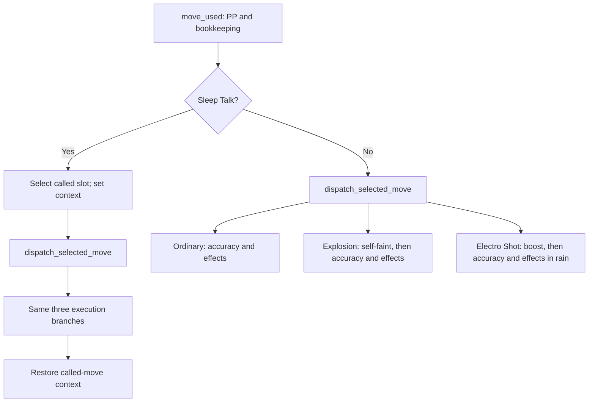
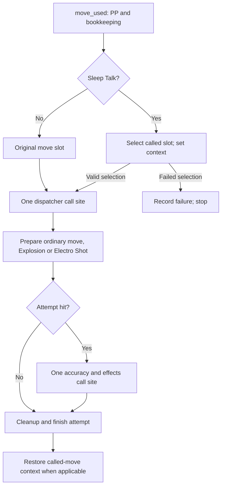

# Compilation memory measurements

The initial full singles step exceeded the tested backend compilation budgets.
Read/write optimizations reduced tracing work; the subsequent dispatch refactor
also reduced backend compilation time and memory for the selected-move
dispatcher and full move execution. Historical measurements are retained below.
Full-battle and transformation acceptance are separate from component checks.

## Measurements

Measurements on 2026-11-13 use fresh CPU processes pinned to two cores, the same
curated seed-0 teams with abilities/items enabled, and a single full step.
Equation counts include each shared nested Jaxpr once. Trace times exclude
fixture construction. RSS is the process high-water mark, including fixture
construction and earlier phases; it is not the size of live battle arrays.

| Implementation | Traced equations | Trace seconds | Peak RSS after trace (MiB) | Peak RSS after lowering (MiB) |
| --- | ---: | ---: | ---: | ---: |
| Before this optimization | 802,117 | 96.234 | 1,801.0 | Not measured separately |
| Shared active gather, direct ability reads, no zero-width padding | 258,034 | 21.794 | 855.7 | 2,280.8 |
| Shared dynamic tree indexing | 81,237 | 9.849 | 633.4 | 1,653.5 |
| Field-only updates and direct hazard/party reads | 70,666 | 7.982 | 618.5 | 1,538.5 |

The final trace has about 91% fewer equations, takes about 92% less time and
uses about 66% less peak RSS at the tracing checkpoint than the original.
These are preparation measurements, not rollout throughput measurements.

## Changes

- `BattleState.ability` gathers the stored ability leaf directly before applying
  volatile overrides and suppression.
- Active snapshots and dynamic `ArrayTree` indexing share cached JAX functions.
  Slice/Ellipsis syntax retains ordinary tree indexing.
- `Move` pads short stat-change vectors only; reconstructing an already-padded
  tree no longer introduces six zero-width padding calls.
- `update_active_fields` writes only named array leaves and emits status events
  when status is part of the update. HP, item, typing and status operations use
  this path. Full `update_active` remains available for Pokémon replacement.
- PP consumption updates its bank leaf directly. Hazard and Beat Up eligibility
  reads avoid constructing unrelated side or party data.

Names of updated fields and index syntax are static Python structure; player
indices, slots, values and random keys remain dynamic. The changes preserve
immutable state and explicit randomness. Focused checks cover full-replacement
equivalence (including dtype casts/events), mechanics regressions and actual
`jit`/`vmap`/`scan` on the shared indexing and update helpers.

## Backend limits before the dispatch refactor

Whole-step backend compilation still failed under a 6 GiB virtual-address cap.
A separate measurement with an 8 GiB virtual cap and a 4 GiB RSS watchdog stopped
the backend at approximately 4.02 GiB RSS. The watchdog samples every 50 ms, so
its threshold is not an exact kernel-enforced RAM limit. Virtual address space
also includes reserved allocator arenas and thread stacks.

Disabling XLA's `call-inliner` pass still exceeded the RSS threshold. Disabling
`flatten-call-graph` as well failed during reset with “Call graph must be
flattened before copy insertion.” Neither experiment is a supported workaround
or a project default.

These experiments motivated reducing the backend's expanded control-flow/call
graph. Shared JAX traces reduce frontend duplication; they do not guarantee that
XLA retains shared calls. The earlier 40-turn eager rollout predates these
optimizations.

## Reproduce

Use the configured project interpreter in a fresh process. On this Linux CPU
environment, the bounded full-step profile is:

```bash
ulimit -c 0
ulimit -v 8388608
taskset -c 0,1 env OMP_NUM_THREADS=1 MPLCONFIGDIR=/tmp/ninjax-mpl \
  .venv/bin/python tools/profile_compile.py --stage compile --rss-limit-mib 4096
```

Use `--stage trace` or `--stage lower` to stop before backend compilation.
`--target ability` isolates the effective-ability read. Reports are JSON lines
with flushed phase progress, elapsed time, peak RSS and traced graph counts.
The script's RSS watchdog exits with code 137 when its threshold is exceeded.
The default RSS limit is zero (disabled); choose a suitable budget explicitly.

## Move-dispatch flow before and after

These diagrams show call sites in the compiled program. At runtime, only the
selected conditional branch executes. Failed Sleep Talk selection stops before
dispatch; a dry Electro Shot charge or a blocked move skips hit resolution.

Before, the two outer branches each call the dispatcher. Within each dispatcher,
three branches can independently call the full accuracy/effect pipeline:



After, selection returns a slot and permission to execute. Special moves prepare
state and return permission to attempt a hit. Each layer then has one common
execution call site:



JAX traces both sides of a dynamic `lax.cond`: the executable must support other
move IDs without recompiling. The full hit pipeline includes status callbacks in
`curated_move_effects.py`, damaging hits, multi-hit scans, abilities, items and
events. Repeating it in separate branches increases the code XLA may expand,
optimize and lower to machine code. A nested `jax.jit` can share a traced Jaxpr
without guaranteeing shared backend code after call-graph flattening/inlining.

Moving selection and preparation before the shared call reduces this expansion.
It preserves PP payment, PRNG order, Explosion's pre-hit faint, Electro Shot's
boost/charge timing and called-move cleanup. It does not mean every move executes
all branches, nor does it establish a faster warmed battle step; that requires a
separate execution benchmark.

## Component compilation tests

`unit_tests/test_component_compilation.py` checks 18 components separately:
ability/active reads, field updates, stats, power, HP, status application,
secondaries, contact effects, one damaging hit, multi-hit resolution, status
moves, before-action checks, switching, field effects, observations, selected-move
dispatch and full move execution. Dispatch executes an already-selected move;
move execution additionally includes PP/bookkeeping and Sleep Talk selection.
These are isolated component checks, not complete battle acceptance.

Each test launches a fresh interpreter with two available CPU cores, an 8 GiB
virtual-address cap, a 4 GiB RSS watchdog, disabled core dumps and a 180-second
timeout. Tests run sequentially. Player and move-slot indices, team metadata and
state remain dynamic inputs to compilation. Curated seed-0 teams use enabled
abilities/items; component-specific move fixtures exercise relevant effects.
For example, contact uses U-turn against Rough Skin and Rocky Helmet, and
multi-hit uses Population Bomb.

The common fixture is constructed before timing starts. Its nested JAX helpers
may already have compiled during reset; the outer component function is new in
each child. RSS checkpoints include this fixture and preparation. Phase timings
exclude fixture construction, while the recorded subprocess wall time includes
fixture construction and eager validation.

After compiling and executing, the test compares every returned leaf with eager
execution using the same input/key. Shapes, dtypes, integer values and PRNG keys
must match exactly. Floating-point leaves must be finite and match within
`rtol=atol=1e-5`. This checks one fixture per component; it is not exhaustive
mechanics parity or a batching/scan check.

Record machine-readable results (including failures) with:

```bash
NINJAX_COMPONENT_REPORT=/tmp/ninjax-components.json \
  MPLCONFIGDIR=/tmp/ninjax-mpl .venv/bin/python -m pytest --run-jit -v \
  unit_tests/test_component_compilation.py \
  --junitxml=/tmp/ninjax-components.xml -o junit_family=legacy
```

The module report includes raw phase checkpoints, graph counts, process exit
codes, error excerpts and wall time. A memory stop, native compiler failure,
timeout or compiled/eager mismatch fails its test; it is not counted as a pass
or silently skipped. The report is written during module teardown even when
tests fail. Normal pytest runs deselect these opt-in `jit` checks.

To run one component directly, use the project interpreter:

```bash
.venv/bin/python tools/profile_compile.py --target hit --stage compile --check \
  --cpu-count 2 --virtual-limit-mib 8192 --rss-limit-mib 4096
```

## Component results before the dispatch refactor

Recorded on 2026-11-13 using Python 3.14.9, JAX 0.12.0.1, jaxlib 0.11.2 and the CPU backend with default XLA flags. The 18 checks ran in three sequential pytest selections with the limits above. **17 passed; full move execution hit the RSS watchdog during backend compilation.** No completed component had a compiled/eager mismatch.

Raw phase records, graph primitive counts and failure output are in [compilation-components.json](compilation-components.json).

| Component | Equations | Trace s | Lower s | Backend s | Peak RSS through compile (MiB) | Result |
| --- | ---: | ---: | ---: | ---: | ---: | --- |
| `ability` | 39 | 0.010 | 0.003 | 0.024 | 520.7 | Pass + eager match |
| `active` | 704 | 0.012 | 0.016 | 0.121 | 533.6 | Pass + eager match |
| `update` | 66 | 0.013 | 0.011 | 0.049 | 532.9 | Pass + eager match |
| `stats` | 1,610 | 0.031 | 0.031 | 0.137 | 534.1 | Pass + eager match |
| `power` | 2,142 | 0.068 | 0.037 | 0.146 | 539.3 | Pass + eager match |
| `hp` | 3,935 | 0.343 | 0.123 | 0.889 | 670.7 | Pass + eager match |
| `status` | 1,768 | 0.053 | 0.047 | 0.251 | 568.9 | Pass + eager match |
| `secondary` | 3,672 | 0.366 | 0.196 | 0.957 | 685.8 | Pass + eager match |
| `contact` | 6,386 | 0.546 | 0.280 | 2.372 | 813.4 | Pass + eager match |
| `hit` | 16,042 | 1.562 | 0.790 | 7.139 | 1,187.3 | Pass + eager match |
| `multi_hit` | 18,306 | 1.826 | 1.299 | 10.049 | 1,324.4 | Pass + eager match |
| `status_move` | 19,153 | 1.776 | 1.100 | 10.185 | 1,562.7 | Pass + eager match |
| `before_move` | 2,702 | 0.167 | 0.226 | 0.869 | 665.8 | Pass + eager match |
| `switch` | 6,597 | 0.563 | 0.278 | 2.994 | 891.9 | Pass + eager match |
| `field` | 11,159 | 0.973 | 0.587 | 4.132 | 1,063.4 | Pass + eager match |
| `observe` | 1,310 | 0.055 | 0.050 | 0.480 | 574.7 | Pass + eager match |
| `dispatch` | 36,286 | 3.877 | 3.467 | 104.575 | 3,530.1 | Pass + eager match |
| `move` | 38,373 | 4.126 | 3.811 | — | 4,111.2 | RSS limit |

Trace/lower/backend columns are phase durations, not cumulative elapsed time. The RSS column is a cumulative process high-water mark through compilation (or the watchdog stop), including fixture construction; later eager-validation peaks remain in the JSON. A dash means compilation did not complete, so no backend duration is reported. These values are observations, not portable performance thresholds.

These baseline results narrowed the investigation to the larger execution graph,
including Sleep Talk selection/calling and bookkeeping, rather than individual
hit arithmetic alone. The tests do not attribute excess memory to a single
compiler pass.

## Dispatch refactor measurements

Both affected components were rerun in fresh processes with the same fixtures,
two cores, default XLA flags and memory/time limits. Both compiled, executed and
matched every eager output leaf, including the PRNG key. Raw checkpoints are in
[compilation-dispatch-refactor.json](compilation-dispatch-refactor.json).

| Component | Equations before → after | Backend seconds before → after | Peak RSS through compilation before → after (MiB) |
| --- | ---: | ---: | ---: |
| `dispatch` | 36,286 → 34,401 | 104.575 → 33.479 | 3,530.1 → 2,238.7 |
| `move` | 38,373 → 36,532 | Did not finish → 34.574 | Watchdog stopped at 4,111.2 → 2,163.2 |

Dispatcher backend time decreased about 68% and its peak process RSS decreased
about 37% in these single-run observations. There is no completed pre-refactor
backend duration for full move execution, so no speedup ratio is reported for
that component. These are not repeated statistical benchmarks or warmed runtime
measurements.

The modest reduction in unique traced equations (about 5% for the dispatcher)
accompanies a much larger backend improvement. This is consistent with fewer
expanded hit-pipeline call sites: the graph counter counts shared nested
Jaxprs once, whereas backend transformations can expand calls at their uses.
The comparison changes both dispatch layers together and does not separately
attribute savings to Sleep Talk versus Explosion/Electro Shot preparation.
