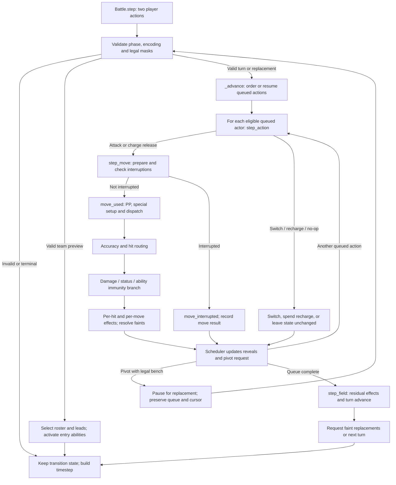
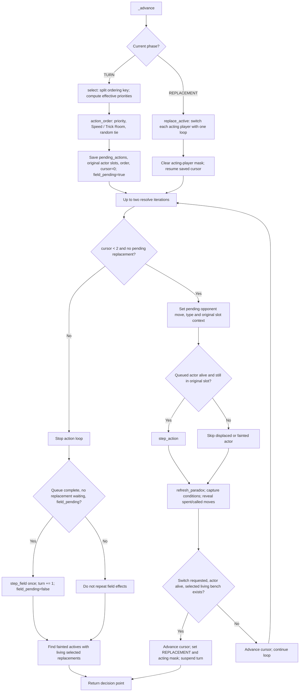
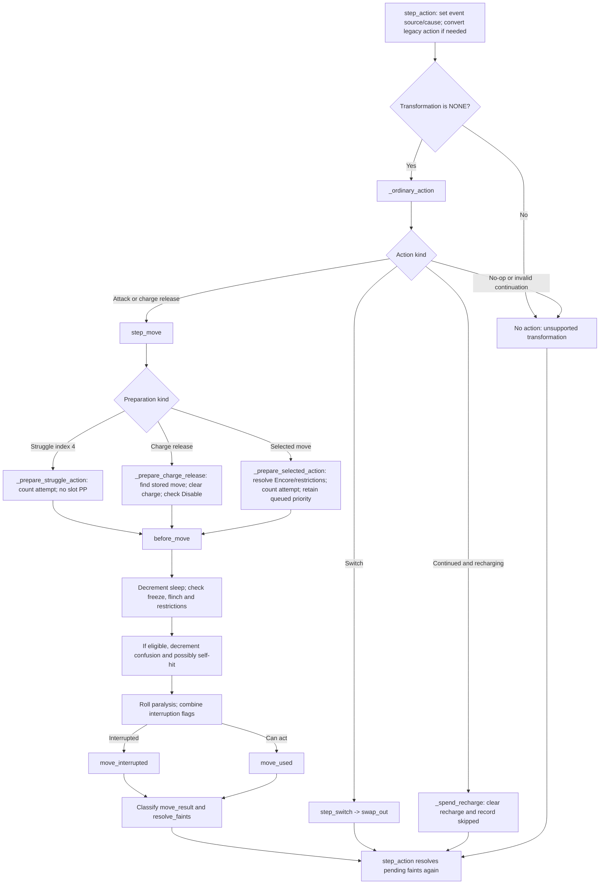
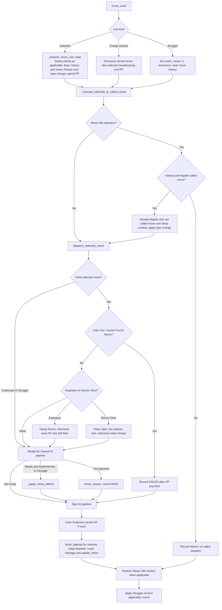
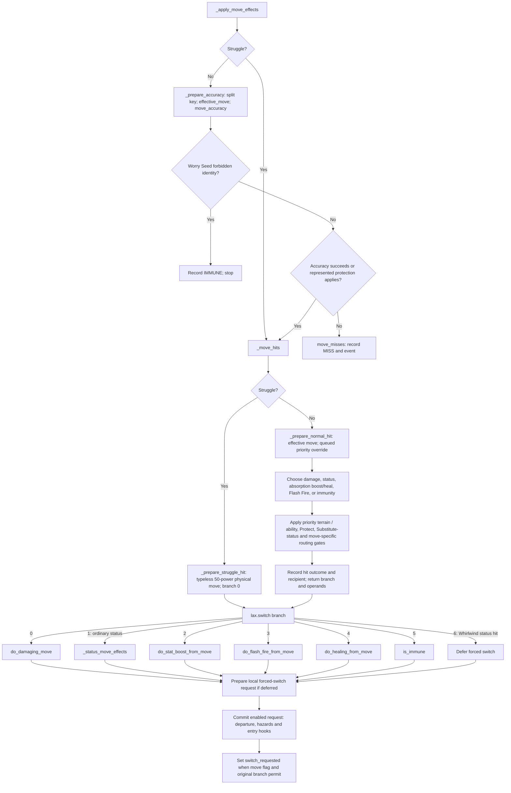
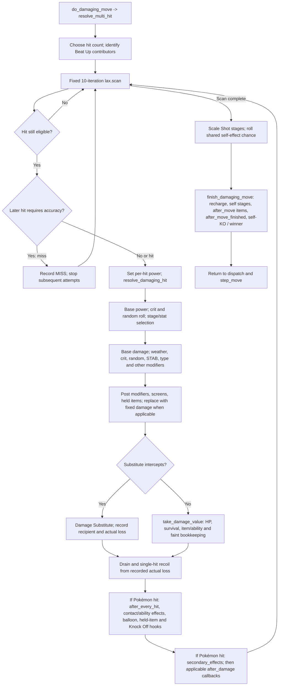
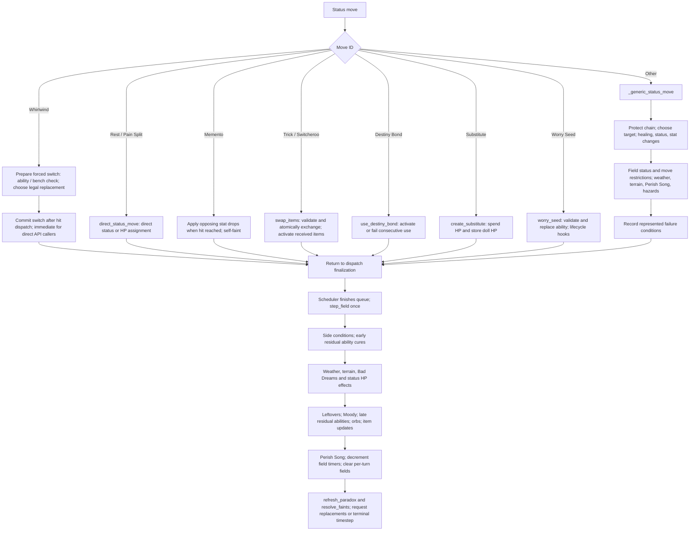

# Move dispatch control flow

These diagrams describe the current **singles implementation**, not a complete
Scarlet/Violet rules specification. Read them in order: the first gives the
whole path; the others expand its major components. The main entry is
[`Battle.step`](../../ninjax/battle/environment.py); move execution is split between
[`battle.py`](../../ninjax/battle/environment.py) and the
[`moves`](../../ninjax/moves/) package. Selection and called moves live in
[`moves.execution`](../../ninjax/moves/execution.py); accuracy, immunity and
hit branch selection live in [`moves.routing`](../../ninjax/moves/routing.py).
See [move mechanics ownership](moves-package.md) for the remaining modules.

Arrows describe logical runtime paths. Branches and loops are primarily
`jax.lax.cond`, `switch`, `fori_loop`, and `scan`: they are traced JAX control
flow, not Python branching on battle values. State is an immutable PyTree;
random draws receive and return explicit keys. An event or hit-result record is
observational bookkeeping, while the battle state drives mechanics.

## 1. High-level path

The initial preview path requires a structured `BattleAction`. A rejected active
player action leaves the transition state unchanged and reports `invalid_action`.
Terminal status, reward, observation, legal masks and timestep are constructed by
`step` after normal advancement. A timeout is a draw under the current policy.

## 2. Scheduling, pivots and replacements

A pivot pauses immediately, then `replace_active` resumes the saved queue. A
faint normally waits until queued actions and field effects finish. `field_pending`
prevents a replacement following a completed turn from running residual effects a
second time. Entry hazards and entry abilities are inside `swap_out`; an entry
faint can lead to another replacement decision. The scheduler also cancels a
queued action when its original active slot has been displaced.

## 3. Action and pre-move handling

Recharge bypasses `before_move`. A charge release does not pay PP again.
Struggle uses a synthetic move and has its own recoil path. In the public action
encoder, non-`NONE` transformations are rejected; the internal `is_tera`
parameter is not evidence of a complete transformation lifecycle.

## 4. Move preparation and special dispatch

For continued moves and Struggle, `dispatch_selected_move` skips its ordinary
`finish_attempt` branch. Sleep Talk spends its own PP but calls its selected
move without spending that move's PP; it preserves and restores calling context.
Unsupported catalogue moves are generally unavailable through the legal mask;
if reached in dispatch, the code records a miss rather than executing effects.

## 5. Accuracy and hit routing

`effective_move` computes transient type, power and priority changes without
rewriting the move slot. Accuracy accounts for the represented stages, items,
abilities and weather; selected absorption/protection paths bypass an ordinary
miss. `_prepare_normal_hit` also records protection and Substitute status blocks,
including represented Spiky Shield retaliation. A damage hit's Substitute routing
is handled later, in `resolve_damaging_hit`.

Whirlwind reaches the deferred branch only after normal routing selects a
status hit. Its preparation handles drag immunity, ability reveals and random
replacement selection; commitment runs after the hit switch and before attempt
finalization. The request is local to this call, with no pending battle-state
field. Direct `do_status_move` callers prepare and commit immediately.

## 6. Damage and per-hit effects

The scan has a fixed size even for a single hit. Initial accuracy is checked
before the scan; some multi-hit moves check later hits independently. The
accumulated `damage` is calculated damage, while `HitResults` records actual
loss for an individual hit. Multi-hit recoil aggregation by total actual HP loss
is not implemented. Only certain `after_damage` callbacks also run after a
Substitute hit. See [passive mechanics](random-battle-passives.md) for supported
ability/item hooks and their limitations.

## 7. Status branch and turn aftermath

The status diagram groups individual generic callbacks; their actual ordering is
the order shown. `step_field` has known limitations around residual ordering and
unrepresented interactions. A move's immediate faint processing and a field
faint are separate from the environment's later terminal reward calculation.
